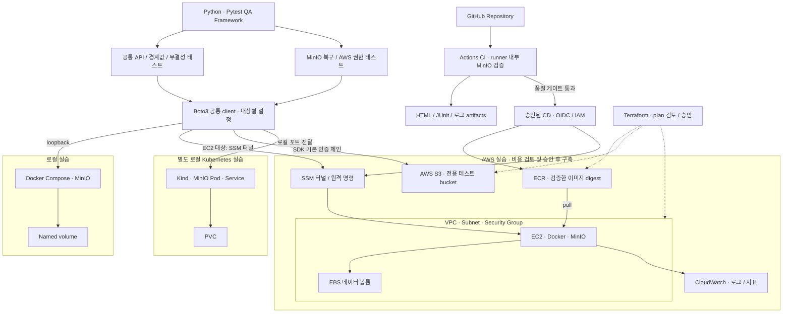

# Cloud Storage Test Automation

S3 호환 오브젝트 스토리지의 기능·인증/인가·데이터 무결성·장애 복구를 검증하는 개인 QA 자동화 프로젝트입니다.
동일한 공통 API 테스트를 로컬 MinIO, EC2의 MinIO, AWS S3에 적용하고, 환경별 차이와 실패 원인을 검증 증거로 남기는 것을 목표로 합니다.

**현재 상태: Phase 2 로컬 MinIO 빌드·실행과 단일 파일 영속성 실습 완료. 공통 API 테스트 프레임워크와 클라우드 인프라는 구현 예정입니다.**

## 검증하려는 문제

- 저장소의 생성·업로드·다운로드·삭제가 정상적으로 동작하는가?
- 파일 크기와 SHA-256을 비교했을 때 데이터가 유지되는가?
- 잘못된 자격증명과 제한된 권한의 요청을 정확하게 거부하는가?
- 컨테이너나 Pod 재생성 후 데이터가 유지되고 서비스가 복구되는가?
- 테스트 실패가 merge와 배포를 차단하고, 분석에 필요한 결과를 남기는가?

## 목표 아키텍처



MinIO와 AWS S3는 별개의 테스트 대상입니다. S3는 EC2 MinIO의 데이터 저장소로 사용하지 않습니다.
SSM을 통한 API 접근은 포트 전달, 배포는 원격 명령으로 구분합니다.
Terraform은 AWS 실습 리소스를 코드로 관리하며, 로컬 Kind는 별도 구성으로 실습합니다.
자세한 데이터 흐름과 설계 근거는 [아키텍처 문서](docs/architecture.md)를 참고하세요.

## 테스트 전략과 품질 기준

| 검증 영역 | 예정 범위 | 판정 및 증거 |
|---|---|---|
| 공통 기능 | bucket/object CRUD, 덮어쓰기, 없는 key, 비어 있지 않은 bucket 삭제 | 응답·오류 코드·조회 결과 |
| 경계값 | bucket 이름 길이, 0B~10MiB 파일 | SDK/서버 검증 구분, 크기 비교 |
| 무결성 | 업로드 전후 데이터 비교 | SHA-256 일치 여부 |
| 인증·인가 | 잘못된 키, 제한 IAM/스토리지 정책 | 허용·거부 결과와 권한 조건 |
| 복구 | MinIO 컨테이너/Pod 재생성 | 데이터 유지, 정상 요청 회복 시간 |
| CI/CD | 의도적인 테스트 실패, 배포 후 smoke | merge/deploy 차단, 로그, 복구 기록 |

실행별 고유 bucket과 cleanup fixture를 설계하고, 공통·provider 전용·파괴 테스트를 분리합니다.
AWS S3에는 컨테이너 장애 주입을 적용하지 않습니다. 파괴 테스트는 명시적으로 지정한 폐기 가능한 대상에서만 실행합니다.

품질 게이트 목표는 필수 테스트 전부 통과, 데이터 불일치와 비인가 성공 0건입니다.
복구 60초는 초기 검증 가설이며, 성능 P95 기준은 환경과 baseline을 측정한 후 정합니다.
전체 테스트 통과율과 성능은 아직 측정하지 않았습니다. Phase 2의 단일 파일 실습에서는 재시작/재생성 명령 시작부터 ready 응답까지의 시간을 관측했으며, 서비스 전체의 복구 기준을 검증한 결과는 아닙니다.

## 기술과 구현 계획

| Phase | 기술 / 실습 | 검증할 역량 및 산출물 | 상태 |
|---|---|---|---|
| 1 | Git/GitHub, Python 3.12, venv | 재현 가능한 의존성, 환경 점검 | 완료 |
| 2 | Docker, Compose, MinIO | health check, volume 영속성 | 로컬 검증 완료 |
| 3 | Boto3, 공통 client, 테스트 설계 | CRUD, 요구사항과 테스트 케이스 연결 | 예정 |
| 4 | Pytest fixture/marker/parameterize | 기능·경계값·권한·무결성 자동화 | 예정 |
| 5 | GitHub Actions CI | HTML/JUnit artifacts, 실패 품질 게이트 | 예정 |
| 6 | EC2/VPC/IAM/EBS/CloudWatch | 접근 통제, 데이터 보존, 관측 | 예정 |
| 7 | ECR, OIDC, CD | 검증한 이미지 digest 배포, smoke와 복구 | 예정 |
| 8 | AWS S3, IAM/정책 | MinIO와 공통 API 비교, 권한 검증 | 예정 |
| 9 | Terraform | fmt/validate/plan, 승인 후 apply/destroy | 예정 |
| 10 | Kind, Kubernetes | Deployment/Service/PVC, probes와 복구 | 예정 |
| 11 | 결과 분석 및 문서화 | 요구사항 추적성, 결함·한계·개선안 | 예정 |

EKS와 성능 부하 도구는 선택 범위입니다. 상세 실습 절차와 면접 질문은 단계별 문서로 관리합니다.

## 현재 확인한 결과와 한계

- Python 3.12.1 가상환경에서 의존성 설치, 패키지 import, `pip check`, 환경 점검을 확인했습니다.
- 직접 의존성은 `requirements.txt`, 간접 의존성을 포함한 20개 설치 버전은 `requirements.lock.txt`에 기록했습니다.
- MinIO 공식 고정 커밋을 Go 1.24.8로 빌드하고 ready/console HTTP 200, 비 root 실행과 loopback 포트 설정을 확인했습니다.
- 1KiB 파일은 재시작·재생성·Compose down/up 후 모두 크기와 SHA-256이 일치했습니다. [실제 결과와 제한](docs/phase-02-results.md)을 함께 기록했습니다.
- 공통 API 테스트와 `--target`, cleanup fixture 및 파괴 테스트 실행 차단은 구현 전입니다.
- CI/CD, AWS 배포, Kubernetes, Linux CI 호환성과 보안 취약점 감사는 미검증입니다.

Phase 1 상세 기록과 원본 실행 자료는 로컬에서 관리합니다. 공개 가능한 결과는 비밀값을 제외한 요약 보고서로 구분합니다.

## 개발 환경 재현

Python 3.12가 설치된 환경에서 실행합니다. 이 명령은 스토리지 서버나 AWS 리소스를 생성하지 않습니다.

```bash
git clone https://github.com/se0kcess/cloud-storage-test-automation.git
cd cloud-storage-test-automation
python3.12 -m venv .venv
source .venv/bin/activate
python -m pip install -r requirements.lock.txt
python -m pip check
python scripts/check_environment.py
```

기대 결과: `No broken requirements found.` 및 `PASS: 개발 환경 확인 완료`.
이 결과는 개발 환경 점검이며 S3 기능 검증 결과가 아닙니다.

## 로컬 MinIO 실습

Docker Desktop을 실행한 뒤 프로젝트 루트에서 진행합니다. 검증 종료 후 서버는 중지했으며 아래 명령으로 다시 실행할 수 있습니다.

```bash
source .venv/bin/activate
python scripts/init_lab_env.py
docker compose build minio
docker compose up -d minio
python scripts/volume_probe.py wait
python scripts/volume_probe.py seed
python scripts/volume_probe.py verify
# 이번 probe가 만든 object/bucket만 정리하고 종료
python scripts/volume_probe.py cleanup
docker compose down
```

API는 `http://127.0.0.1:9000`, 콘솔은 `http://127.0.0.1:9001`입니다.
버전·소스 해시·명령·영속성 실험 순서는 [Phase 2 가이드](docs/phase-02-minio.md)에 기록했습니다.
단일 인스턴스·단일 파일 실습이며 HA나 전체 데이터 내구성을 입증한 결과가 아닙니다.

## 보안 및 비용 원칙

자격증명·`.env`·Terraform state는 Git에 저장하지 않습니다.
AWS 인증은 SDK 기본 인증 체인을 사용하고, Actions의 AWS 접근은 OIDC와 최소 권한 역할로 설계합니다.
MinIO는 격리된 실습 환경에 두고 포트를 인터넷에 공개하지 않습니다.
MinIO upstream은 아카이브 상태입니다. 마지막 공식 릴리스 소스를 고정해 학습용으로만 빌드하며 운영 환경에는 사용하지 않습니다.
현재 환경의 Docker 20.10에는 localhost 게시 포트에 관한 구버전 제약이 있어 네트워크 격리를 완전히 검증했다고 주장하지 않습니다. 신뢰할 수 없는 네트워크에서 재실행하기 전 Docker 갱신이 필요합니다. [Docker 공식 설명](https://docs.docker.com/engine/network/port-publishing/)
AWS 생성·배포·삭제는 비용과 변경 범위를 검토하고 명시적으로 승인한 후 실행합니다.

## 문서

- [프로젝트 요구사항](docs/PROJECT_SPEC.md)
- [아키텍처와 실습 흐름](docs/architecture.md)
- [Phase 1: 개발 환경 구축 및 트러블슈팅](docs/phase-01-setup.md)
- [Phase 2: MinIO·Docker 영속성 실습](docs/phase-02-minio.md)
- [Phase 2: 실제 실행 결과](docs/phase-02-results.md)
