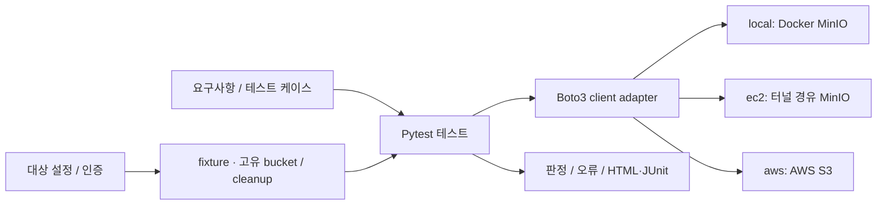

# 아키텍처와 실습 흐름

이 문서는 목표 설계다. 현재 구현 범위는 Phase 2의 로컬 MinIO와 단일 파일 영속성 실습까지다. [실제 결과](phase-02-results.md)와 앞으로 구현할 전체 구성을 구분한다.
전체 구성도는 [README](../README.md)의 목표 아키텍처를 참고한다.

## 1. QA 프레임워크: 같은 검증을 다른 대상으로 실행

테스트는 ‘어떤 동작을 검증하는지’를 표현하고 client는 endpoint·리전·주소 지정 방식을 담당한다.
fixture는 대상 검증, 테스트 자원 준비와 정리를 담당한다. 대상 선택 옵션 `--target`은 구현 예정이며 아직 사용할 수 없다.
MinIO는 endpoint와 path-style 설정을 사용하고 AWS S3는 SDK 기본 인증 체인을 사용한다.
공통 테스트를 공유하되 provider별 오류와 권한 차이를 억지로 같은 값으로 처리하지 않는다.

실습에서는 먼저 Boto3로 CRUD를 수동 실행해 API를 이해하고, 이후 Pytest assertion과 fixture로 옮긴다.
파일은 업로드 전과 다운로드 후의 크기 및 SHA-256으로 검증한다.
테스트 bucket은 실행별 이름으로 격리하고 cleanup은 해당 실행이 생성한 자원에만 적용한다.
정리 실패도 기록해 테스트 성공과 자원 정리 성공을 구분한다.

## 2. 로컬 MinIO: 서버와 데이터 수명 분리

Docker Compose로 학습용 MinIO 단일 인스턴스를 실행하고 포트는 loopback에만 바인딩한다.
컨테이너의 데이터 경로를 named volume에 연결해 컨테이너 재생성과 데이터 삭제를 구분한다.
health check가 정상 요청 가능 상태를 나타내는지 확인한 후 CRUD를 시작한다.

실습 순서는 업로드 → 컨테이너 재시작 → 다운로드/해시 비교 → 컨테이너 재생성 → 동일 검증이다.
volume을 삭제하면 데이터 보존 조건 자체가 달라지므로 재생성 테스트와 volume 삭제를 혼동하지 않는다.
Phase 2에서 공식 릴리스 RELEASE.2025-10-15T17-29-55Z의 소스 커밋·해시와 빌더/런타임 이미지 digest를 고정해 로컬 빌드를 검증했다. upstream은 아카이브 상태이므로 격리된 학습용으로만 사용한다.

## 3. CI/CD: 테스트 결과를 변경 승인 근거로 사용

목표 흐름은 다음과 같다.

1. PR 또는 지정 브랜치 변경으로 CI를 시작한다.
2. 이미지를 준비하고 runner 내부에 격리된 MinIO를 실행한다.
3. health check 후 smoke/regression/security 테스트를 실행한다.
4. 실패해도 HTML/JUnit/로그 보존과 테스트 자원 정리를 시도한다.
5. 필수 CI check와 저장소 규칙으로 실패한 변경의 merge를 차단한다.
6. 승인된 배포 경로에서 CI가 검증한 동일 이미지 digest를 ECR에 게시하고 EC2에 배포한다.
7. EC2 배포 후 smoke를 실행하고 실패 시 이전 digest로 복구하는 절차를 검증한다.

CI에서 검증하는 배포 이미지는 Phase 2에서 선택한 MinIO 실습 이미지다.
빌드 산출물을 다시 빌드해 배포하지 않도록 digest와 출처를 기록한다. ECR 게시와 검사 순서의 구체적인 workflow는 Phase 7에서 확정한다.
CD용 AWS 권한은 신뢰한 저장소·브랜치 또는 environment의 OIDC 요청으로 제한한다.
GitHub OIDC subject 형식은 구현 시 실제 저장소 설정과 발급 claim을 확인한다.
외부 PR에 배포 권한이나 실환경 자격증명을 제공하지 않는다.

일반 CI는 runner 내부 MinIO를 사용하므로 사설 EC2로 직접 접근할 필요가 없다.
EC2 smoke는 EC2 내부에서 SSM 원격 명령으로 실행하거나, 승인된 runner에서 SSM 포트 전달로 실행한다.
구현 시 선택한 경로와 필요한 IAM·SSM Agent·네트워크 연결 조건을 함께 검증한다.

## 4. AWS: 컴퓨트·디스크·관리형 스토리지를 분리해서 이해

| 구성요소 | 이 프로젝트에서의 역할 | 실습 질문 |
|---|---|---|
| VPC / Subnet / Security Group | 실습 자원의 네트워크와 접근 경계 | 허용한 연결만 도달하는가? |
| EC2 | Docker와 MinIO를 실행할 서버 | 같은 이미지가 로컬과 클라우드에서 동작하는가? |
| EBS | EC2 MinIO의 데이터 디스크 | 컨테이너 재생성 후 올바른 mount 경로에 데이터가 남는가? |
| S3 | 별도의 관리형 오브젝트 스토리지 테스트 대상 | 공통 API와 IAM/정책 검증 결과가 어떻게 다른가? |
| ECR | 배포 이미지 보관 | 검증한 digest가 실제 실행 이미지와 일치하는가? |
| IAM / OIDC | 테스트·배포·인스턴스별 권한 | 필요한 작업만 허용하고 나머지를 거부하는가? |
| SSM | 관리 접근, 포트 전달 및 배포 명령 | MinIO 포트를 공개하지 않고 검증 가능한가? |
| CloudWatch | 로그와 지표 수집 | 실패 시각과 서버 상태를 연결할 수 있는가? |

S3는 MinIO의 뒷단 디스크로 연결하지 않는다. EC2 MinIO는 EBS를 사용하고 AWS S3는 별도로 검증한다.
EBS 연결만으로 영속성이 보장되는 것은 아니므로 mount, 데이터 경로, 삭제 정책을 확인한다.
단일 EC2/MinIO는 고가용성 구성이 아니다. EC2 교체·EBS 재연결은 컨테이너 재시작보다 별도의 복구 범위다.

AWS 리전은 서울을 후보로 두고 Phase 6에서 정책과 비용을 확인한다.
Subnet의 공개/사설 여부, 서비스 연결 경로, NAT 또는 VPC endpoint 사용은 비용·접근 요건과 함께 확정한다.
MinIO 9000/9001의 인터넷 인바운드는 허용하지 않는다. SSM을 쓰려면 인스턴스에서 필요한 AWS 서비스에 도달할 수 있어야 한다.

## 5. Terraform과 Kubernetes: 서로 다른 자동화 계층

Terraform은 VPC·EC2·EBS·IAM 등 선택한 AWS 리소스의 구성을 코드로 반복 가능하게 관리한다.
기존 수동 실습 리소스를 코드로 전환할 때는 import 또는 교체 여부를 plan으로 검토해 중복 생성을 피한다.
fmt → validate → plan → 비용/변경 검토 → 승인 → apply 순서로 진행하고 state와 비밀값은 Git에서 제외한다.
삭제도 별도 승인과 범위 검토 후 수행하며 잔존 자원을 확인한다.

Kind는 로컬 Docker 환경에서 Kubernetes를 학습하는 별도 경로다.
Deployment로 MinIO Pod를 관리하고 Service로 접근하며 PVC로 데이터를 연결한다.
readiness는 요청을 받을 준비 상태, liveness는 재시작이 필요한 상태를 판단하도록 설계한다.
Pod 삭제 전후 파일 해시와 readiness 회복 시간을 측정한다.
단일 인스턴스의 데이터 디스크를 여러 Pod가 동시에 쓰지 않도록 배포 전략과 volume 접근 조건을 검토한다.

PVC 검증은 Pod 재생성 범위에서 시작한다. Kind 클러스터 삭제나 노드 손실까지의 데이터 내구성을 검증했다고 주장하지 않는다.
EKS와 부하 도구는 선택이며 기본 실습에는 포함하지 않는다.

## 포트폴리오 증거로 남길 내용

요구사항 ID → 테스트 케이스 → 자동화 코드 → 실제 실행 결과 → 결함/제약을 연결한다.
통과 수치뿐 아니라 실패 재현 조건, 기대/실제 결과, 로그, 원인, 수정 후 재검증 결과를 기록한다.
측정하지 않은 성능·복구 시간이나 구현하지 않은 기능을 완료 성과로 표시하지 않는다.
README에는 프로젝트 개요·아키텍처·현재 결과를 두고, 학습 명령·트러블슈팅·면접 질문·커밋 메시지는 단계별 가이드에 둔다.

## 참고 문서

- [GitHub Actions OIDC와 AWS](https://docs.github.com/en/actions/how-tos/secure-your-work/security-harden-deployments/oidc-in-aws)
- [AWS Session Manager 세션과 포트 전달](https://docs.aws.amazon.com/systems-manager/latest/userguide/session-manager-working-with-sessions-start.html)
- [AWS S3 개요](https://docs.aws.amazon.com/AmazonS3/latest/userguide/Welcome.html)
