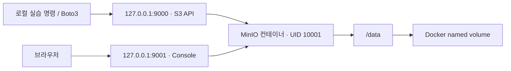

# Phase 2 — Docker·MinIO와 데이터 영속성

## 1. 실습 목적

로컬 S3 호환 서버를 반복해서 실행할 수 있게 만들고, 컨테이너와 저장 데이터의 수명을 구분한다.
완료 기준은 이미지 빌드, 준비 상태 확인, 로컬 포트 바인딩 확인, 재시작/재생성 후 동일 데이터 조회다.
AWS 리소스는 만들지 않는다. Boto3 공통 client와 Pytest 자동화는 Phase 3~4에서 진행한다.

## 2. 관련 개념과 동작 원리



- 이미지는 실행 파일과 파일시스템의 틀이다. 컨테이너는 해당 이미지의 실행 인스턴스다.
- multi-stage build는 Go 컴파일 환경과 MinIO 실행 환경을 나눠 런타임에 빌드 도구를 넣지 않는다.
- named volume은 컨테이너와 독립적으로 데이터를 보존한다. `/data` 연결을 빠뜨리면 재생성 시 데이터를 잃을 수 있다.
- health check는 프로세스 존재만 보는 대신 `/minio/health/ready`의 성공 여부를 확인한다. API 기능·권한·무결성 전체를 보장하지는 않는다.
- `restart`는 같은 컨테이너를 재시작한다. `up --force-recreate`는 새 컨테이너로 교체한다. 두 작업 모두 같은 volume을 사용해야 한다.
- `down`은 컨테이너/네트워크를 제거하지만 기본적으로 named volume은 보존한다. `down -v`는 데이터를 삭제하므로 이번 실습에서는 사용하지 않는다.
- 전용 bridge 네트워크를 사용하고 공개 포트는 loopback에만 연결한다. 컨테이너의 외부 송신이나 같은 Mac의 다른 프로세스까지 차단하는 구성은 아니다.
- Docker 공식 문서는 28.0.0 이전의 localhost 게시 포트가 같은 L2 네트워크에서 접근될 수 있다고 명시한다. 현재 Docker 20.10 환경에서 LAN 격리 여부는 검증하지 않았다. 검증 후 서버는 중지했으며, 신뢰할 수 없는 네트워크에서 재실행하기 전 Docker를 갱신한다.

## 3. 구현 방법과 코드

| 파일 | 역할 |
|---|---|
| `infra/Dockerfile` | 고정 소스 다운로드·해시 검증·Go 빌드·비 root 런타임·health check |
| `compose.yaml` | 고정 로컬 이미지명, loopback 포트, 환경변수, named volume, 전용 네트워크 |
| `.dockerignore` | .env/.git/.venv/reports를 build context에서 제외 |
| `scripts/init_lab_env.py` | 기존 파일을 덮어쓰지 않고 0600 권한의 .env 생성 |
| `scripts/volume_probe.py` | 로컬 전용 1KiB 파일의 seed/verify/cleanup 및 준비 대기 |

### 버전 선택 근거

2026-11-28 공식 upstream 확인 기준:

- MinIO 저장소는 2026-04-25 아카이브되어 읽기 전용이다. 이 구성은 격리된 학습용이며 운영 배포용으로 검증하지 않았다.
- 마지막 공식 릴리스는 `RELEASE.2025-10-15T17-29-55Z`다. 릴리스 assets 목록은 비어 있어 공식 소스 직접 빌드 경로를 선택했다.
- 태그 커밋: `9e49d5e7a648f00e26f2246f4dc28e6b07f8c84a`.
- 커밋 소스 tar.gz SHA-256: `45521908307306e925c98d629e1c17d78c8b72b6ee242b1bfb1409f7d8ee5841`.
- 해당 go.mod는 Go 1.24.0과 toolchain 1.24.8을 지정한다. 빌더는 `golang:1.24.8-alpine3.22`를 사용한다.
- 런타임은 `alpine:3.22.2`다. 두 이미지 모두 레지스트리의 manifest digest로 고정하고 arm64 지원을 확인했다. 정확한 digest는 Dockerfile에 기록했다.
- `-mod=readonly`와 upstream go.sum으로 Go 의존성을 검증한다. 보안 취약점이 없음을 보장하는 것은 아니다.

로컬 이미지 태그는 `cloud-storage-qa/minio:release-2025-10-15-lab1`이다. 로컬 태그는 변경 가능하므로 실제 실행 결과에는 image ID도 기록한다.
MinIO의 AGPL 라이선스·NOTICE를 런타임 이미지에 포함하며, 출처와 빌드 방법을 공개한다.

### 자격증명 취급

`.env.example`은 비어 있는 항목만 저장한다. `init_lab_env.py`가 생성한 `.env`는 Git과 build context에서 제외된다.
Compose는 계정/비밀번호가 비어 있으면 실행을 거부한다. `.env`와 Compose 환경변수가 변경되면 기존 컨테이너는 재생성해야 반영된다.
로컬 파일에는 단순한 `KEY=value` 형식을 사용한다. 실습 스크립트의 로더는 범용 dotenv 문법을 지원하지 않는다.
Compose와 실습 스크립트는 프로세스의 `MINIO_ROOT_USER/PASSWORD`를 우선하므로 의도하지 않은 override가 없는지 확인한다.
`docker compose config`나 전체 `docker inspect`는 비밀값을 보여줄 수 있으므로 검증에는 `config --quiet`와 선택한 필드만 사용한다.
콘솔 로그인 정보는 에디터에서 `.env`를 확인하고 직접 입력한다. 소스·로그·보고서에 복사하지 않는다.

## 4. 터미널 실행 명령어

프로젝트 루트에서 실행한다. 기존 .venv와 Docker Desktop이 필요하다.

```bash
source .venv/bin/activate
python scripts/init_lab_env.py
docker compose config --quiet
docker compose build minio
docker compose up -d minio
python scripts/volume_probe.py wait
docker compose ps
curl --fail http://127.0.0.1:9000/minio/health/ready
```

브라우저 콘솔 주소: http://127.0.0.1:9001 . 콘솔의 기능과 S3 API의 기능 검증은 구분한다.
아래 probe는 이 실습을 위한 최소 보조 도구이며 전체 CRUD 자동화가 아니다.

```bash
# 1. 고유 bucket에 1KiB 파일 생성. 해시/크기는 reports/에 기록
python scripts/volume_probe.py seed
python scripts/volume_probe.py verify

# 2. 재시작 후 확인: 같은 컨테이너
# 아래 명령은 이번 Compose MinIO 서비스만 대상으로 한다.
docker compose restart minio
python scripts/volume_probe.py wait
python scripts/volume_probe.py verify

# 3. 재생성 후 확인: 새 컨테이너, 같은 volume
docker compose up -d --force-recreate minio
python scripts/volume_probe.py wait
python scripts/volume_probe.py verify

# 4. 컨테이너/네트워크 제거 후 다시 구성: volume 보존
docker compose down
docker compose up -d minio
python scripts/volume_probe.py wait
python scripts/volume_probe.py verify
```

실습 완료 후 사용자가 만든 다른 데이터는 유지하고, 이번 probe의 단일 object/bucket만 정리한다.

```bash
python scripts/volume_probe.py cleanup
docker compose down
```

같은 명령을 공유 서버나 운영 서비스에 적용하지 않는다. volume 삭제는 이번 단계의 실습 명령에 포함하지 않는다.

## 5. 기대 결과 및 검증 방법

- `build`가 성공하고 `docker compose run --rm --no-deps minio --version`에서 고정한 release/commit을 확인한다.
- `ps`에 `healthy`가 표시되고 ready endpoint는 HTTP 200을 반환한다. 본문이 비어 있어도 정상일 수 있다.
- `seed`는 고유한 `phase02-...` bucket을 출력한다. 각 verify는 `VERIFIED: 1024B / SHA-256 일치`를 출력해야 한다.
- 재시작 전후 컨테이너 ID는 같고 재생성 후에는 달라야 한다. 데이터 volume 이름은 같아야 한다.
- 시작·재생성 직후 요청이 실패할 수 있으므로 준비 상태를 확인한 후 파일을 조회한다.
- `READY: 대기 ...초`는 probe를 실행한 뒤의 대기 시간이며 장애 발생부터 전체 복구까지의 시간은 아니다.
- 단일 파일·단일 인스턴스의 성공으로 전체 내구성/HA/성능이 검증됐다고 해석하지 않는다.

```bash
docker compose ps -q minio
# 위 ID를 사용해 필요한 필드만 조회한다.
docker inspect --format '{{json .NetworkSettings.Ports}}' CONTAINER_ID
docker inspect --format '{{range .Mounts}}{{println .Type .Name .Destination}}{{end}}' CONTAINER_ID
```

TC-010(컨테이너 재시작/재생성)과 TC-004(크기/해시)의 일부를 수동 실습으로 확인한다.
0B~10MiB 전체 범위, 권한, 결함 주입, CI gate는 아직 이 결과에 포함하지 않는다.
실제 실행 결과와 제한은 [Phase 2 실행 결과](phase-02-results.md)에 기록한다.

## 6. 트러블슈팅

| 증상 | 확인과 조치 |
|---|---|
| Docker daemon 연결 실패 | Docker Desktop 상태와 context 확인. 샌드박스 접근 제한과 daemon 중지를 구분 |
| 빌드가 오래 걸림 | 첫 빌드는 Go 의존성 다운로드와 컴파일이 필요. 디스크/메모리/네트워크 확인 |
| No space left on device | `df -h .` 및 `docker system df` 확인. 사용자 데이터/volume을 임의로 정리하지 않음 |
| manifest inspect에서 OCI 오류 | 이 환경의 Docker 20.10 CLI 조회 제한. 고정 digest를 사용한 실제 build/pull과 구분 |
| healthy인데 호스트 연결 거부 | 내부 health와 실제 요청 경로를 별도로 확인. 이번 Docker 20.10의 internal 네트워크에서 포트 미게시를 재현했고 전용 bridge + loopback 바인딩으로 수정 |
| 9000/9001 이미 사용 중 | `docker ps` 또는 `lsof -nP -iTCP:9000 -sTCP:LISTEN` 확인. 기존 서비스를 임의로 종료하지 않음 |
| 계정 값이 비었다는 Compose 오류 | init_lab_env 실행. 기존 .env는 자동 덮어쓰기하지 않음 |
| health unhealthy | 선택한 컨테이너 상태와 접근 가능한 로그 확인. startup 지연, mount 권한, 디스크 확인 |
| Permission denied /data | volume mount와 컨테이너 UID 10001 확인. root 실행이나 chmod 777로 우회하지 않음 |
| verify 실패 | 같은 Compose 프로젝트와 volume인지 확인. reports의 실습 기록 및 해당 bucket 존재 확인 |
| cleanup 중 BucketNotEmpty | probe 이외 object가 존재. 재귀 삭제하지 않고 내용을 확인 |
| 브라우저에서 로그인 실패 | .env 계정과 환경변수 override, 컨테이너 재생성 여부 확인 |

## 7. 예상 질문

1. **컨테이너 재시작과 재생성 테스트를 왜 구분하는가?** 재시작은 같은 writable layer를 유지한다. 재생성은 새 인스턴스이므로 외부 volume 연결의 정확성까지 확인할 수 있다.
2. **named volume은 백업인가?** 아니다. 컨테이너와 분리된 저장소지만 volume/호스트 삭제나 디스크 손실에 대한 별도 복구 수단은 아니다.
3. **health check 성공이면 기능 정상인가?** 아니다. 별도로 인증된 S3 요청과 데이터 해시 검증을 수행해야 한다.
4. **이미지 태그와 digest의 차이는?** 태그는 다른 이미지로 바뀔 수 있는 이름이고 digest는 특정 manifest를 식별한다.
5. **왜 최신 이미지 대신 소스를 빌드했는가?** 마지막 공식 릴리스의 제공 형태와 소스/도구 요구사항을 확인하고, 검증 가능한 고정 커밋을 선택했다. 운영 적합성은 별도 판단이다.
6. **SHA-256을 왜 비교하는가?** 상태 코드나 파일 크기만으로 발견하지 못하는 데이터 변경을 확인하기 위해서다.
7. **왜 loopback 바인딩과 비 root 실행을 적용했는가?** 실습 서버의 접근 범위와 컨테이너 프로세스 권한을 필요한 범위로 제한하기 위해서다.

## 8. Git 커밋 메시지

권장 메시지: `feat: add isolated MinIO lab and persistence verification`

먼저 기존 README/architecture 변경과 Phase 2 파일을 구분해 검토한다. 실제 비밀값이 담긴 .env와 reports는 커밋하지 않는다.

```bash
git status --short
git diff --check
git diff
# 검토한 파일만 git add로 선택한 후
git diff --cached
git commit -m "feat: add isolated MinIO lab and persistence verification"
```

현재 요청은 로컬 Phase 2 실습이다. 원격 push는 별도 요청 시 진행한다.

## 공식 근거

- [MinIO 저장소와 아카이브 상태](https://github.com/minio/minio)
- [선택한 MinIO 릴리스와 소스 빌드 안내](https://github.com/minio/minio/releases/tag/RELEASE.2025-10-15T17-29-55Z)
- [해당 릴리스 go.mod](https://github.com/minio/minio/blob/RELEASE.2025-10-15T17-29-55Z/go.mod)
- [Docker Compose down과 volume](https://docs.docker.com/reference/cli/docker/compose/down/)
- [Docker 포트 게시와 구버전 localhost 제약](https://docs.docker.com/engine/network/port-publishing/)
